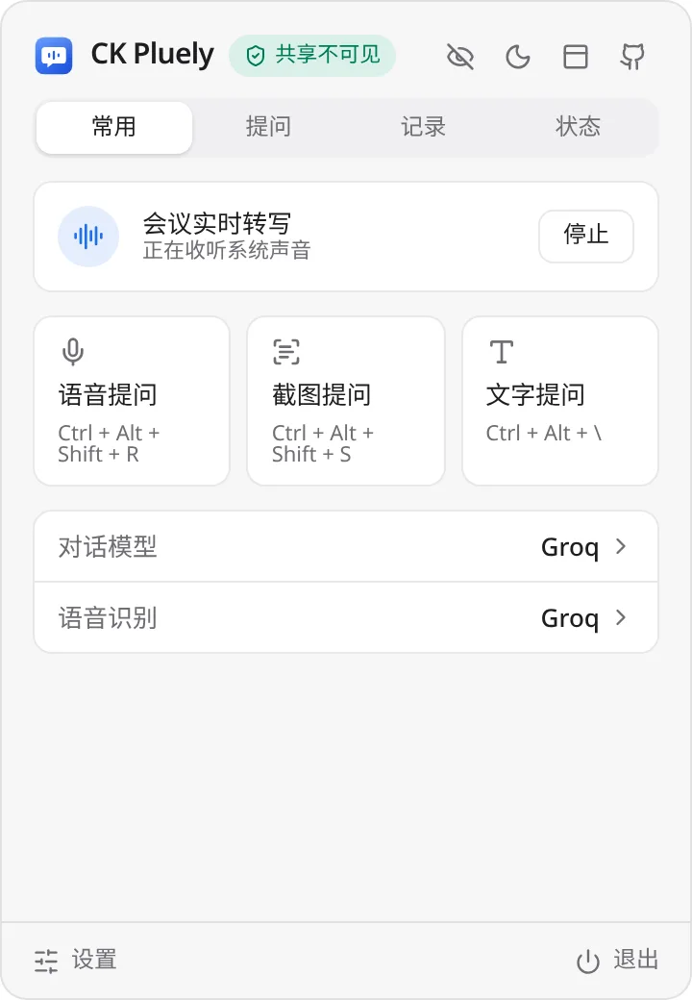
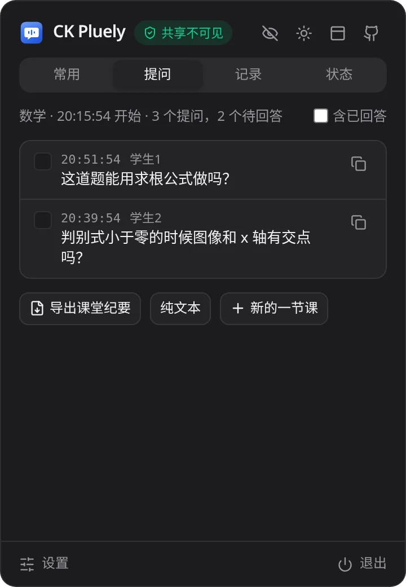
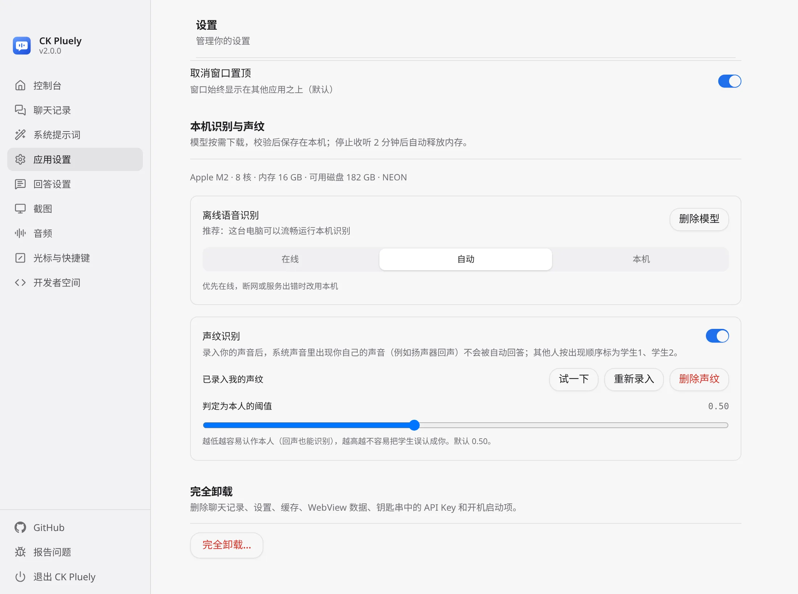
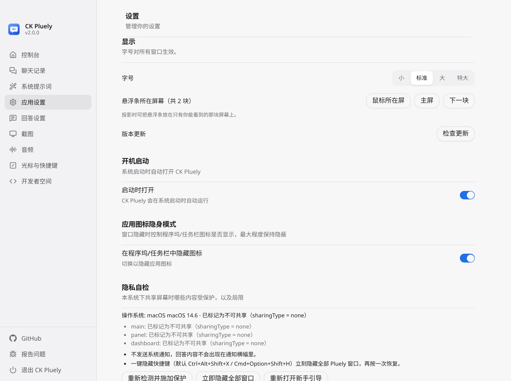
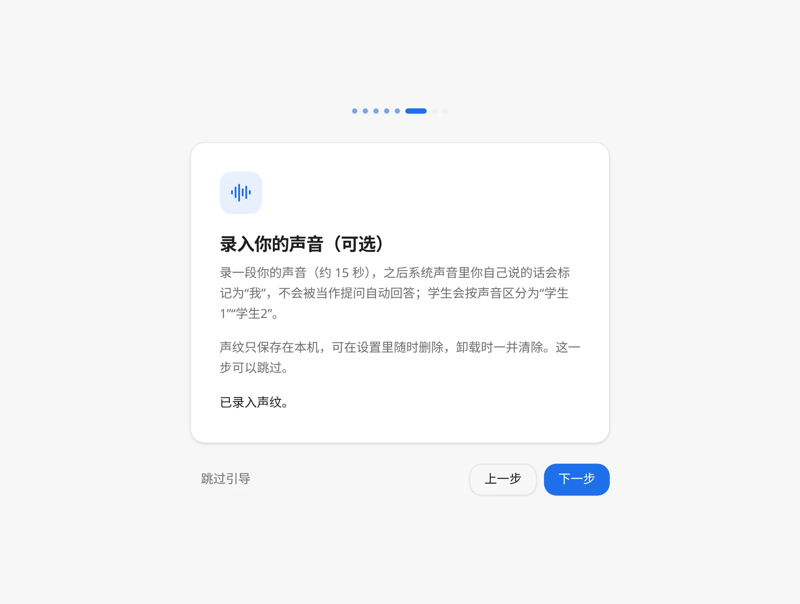

# CK Pluely

**简体中文** | [English](./README.en.md)

面试、上课答疑、会议时用的实时助手：采集对方的声音，实时转成文字，判断是否在提问，然后给出要点优先的简短回答。所有窗口开启内容保护，屏幕共享时对方看不到（请先用自己的腾讯会议 / Zoom 自测）。

基于 Pluely 开源版 v0.1.9（Srikanth Nani，GPL-3.0）二次开发，维护者 CKNB，仓库 <https://github.com/CKNB888/ck-pluely>。包标识 `io.github.cknb6.ckpluely`，可与上游同时安装。当前版本 **v2.1.0**，支持 macOS（Apple 芯片 / Intel）、Windows、Linux。

## 功能总览

| 功能 | 说明 |
|---|---|
| 菜单栏 / 托盘面板 | 「常用 / 提问 / 记录 / 状态」四页；也可切换为悬浮条 |
| 实时转写与自动回答 | 系统声音 + 麦克风；Groq whisper 在线识别，多 Key 轮换，限流自动切换 |
| 本地语音识别 | SenseVoice（约 240 MB，按需下载并校验），断网 / 限流时自动切到本地 |
| 声纹 | 录入自己的声音后，自己说的话不触发回答，记录中标为「我」 |
| 上课模式 | 第一行加粗结论、最多 3 点、==高亮== 关键词、150 字内；10 个科目预设；LaTeX 公式与代码高亮 |
| 提问列表 | 自动收集问题，标记已回答，导出课堂纪要（Markdown）或纯文本 |
| 截图 / 语音 / 文字提问 | 截图自动缩放后发送；对话模型可选 Groq、OpenAI、Anthropic、Gemini、DeepSeek 等 |
| 快速低耗（v2.1.0） | 连接池 + 预热，首字时间约减半；按模式限制输出、低推理强度、历史压缩，输出 tokens 约减半；显示用量 |
| 打开即监听（v2.1.0） | 自动识别腾讯会议、钉钉、飞书、企业微信、Zoom、Teams 等，优先只采集会议软件的声音；面板显示「正在监听：腾讯会议」 |
| 备份与恢复（v2.1.0） | `.ckbak` 单文件，校验 + 差异预览 + 失败回滚，可加密包含 API Key；升级前自动备份 |
| 隐私 | 内容保护、隐私状态指示、一键隐藏全部窗口 |
| 完全卸载 | 应用内一键删除；各平台卸载程序同步清理 |

## 界面截图

| | |
|---|---|
| <br>面板：常用 | <br>面板：提问列表 |
| <br>深色模式 | <br>本地语音识别与配置建议 |
| <br>显示：字号、屏幕、检查更新 | <br>首次引导：录入你的声音 |

## 安装

到 [Releases](https://github.com/CKNB888/ck-pluely/releases) 下载对应系统的安装包：

- **macOS**：Apple 芯片选 `aarch64`，Intel 选 `x64`，`.dmg` 或 `.pkg` 均可。应用未经公证，首次请右键 → 打开，或执行 `xattr -cr "/Applications/CK Pluely.app"`；然后在「系统设置 → 隐私与安全性」授予麦克风、屏幕与系统录音权限
- **Windows**：`-setup.exe` 或 `.msi`；SmartScreen 提示时点「更多信息 → 仍要运行」
- **Linux**：`.deb` / `.rpm` / `.AppImage`

首次启动有引导：权限 → 填写 Groq Key 并测试 → 快捷键 → 录入声音（可跳过）→ 隐私自检。

## 快速上手

1. 首次引导里填入 console.groq.com 申请的 Key（对话与语音识别共用，只保存在本机钥匙串 / 凭据管理器）
2. 打开面板 →「常用」中开始会议转写；上课答疑选「上课」预设和科目
3. 对方提问时自动给出回答（第一行就是结论）；「提问」页回看所有问题并导出
4. 回答下方显示本次 tokens 与首字时间

## 快捷键

| 作用 | Windows / Linux | macOS |
|---|---|---|
| 显示 / 隐藏 | `Ctrl+Alt+\` | `⌘⌥\` |
| 截图提问 | `Ctrl+Alt+Shift+S` | `⌘⌥⇧S` |
| 语音输入 | `Ctrl+Alt+Shift+R` | `⌘⌥⇧R` |
| 系统声音（会议转写） | `Ctrl+Alt+Shift+M` | `⌘⌥⇧M` |
| 一键隐藏全部 | `Ctrl+Alt+Shift+X` | `⌘⌥⇧H` |
| 打开控制台 | `Ctrl+Alt+Shift+D` | `⌘⌥⇧D` |
| 聚焦输入框 | `Ctrl+Alt+Shift+I` | `⌘⌥⇧I` |
| 移动窗口 | `Ctrl+Alt+Shift+方向键` | `⌘⌥⇧方向键` |

快捷键可在设置中修改。

## 升级

直接安装新版本覆盖即可，记录与设置保留。v2.1.0 起，首次启动新版本时会在改写任何数据前自动导出一份升级前备份（保留最近 5 份，可在「设置 → 备份与恢复」中查看）。

## 备份与恢复

设置 →「备份与恢复」：
- **导出**：生成 `.ckbak`（zip + `manifest.json`，含格式版本、应用版本、时间与逐文件 SHA-256），包含设置、对话与提问记录（SQLite 一致快照）、提示词、声纹；本地模型可选。API Key 默认不导出，设置口令后加密（PBKDF2-SHA256 + AES-256-GCM）一并导出
- **恢复**：先校验并显示将要变化的内容，确认后自动保存一份当前数据的安全备份，再整体替换；任一步失败自动回滚。旧版本格式会自动迁移

## 卸载

- **应用内**：设置 → 完全卸载，删除记录、设置、模型和保存的密钥，然后退出
- **Windows**：在「设置 → 应用」卸载；卸载程序会询问是否同时删除数据
- **Linux**：`sudo apt purge ck-pluely` 或 `sudo dnf remove ck-pluely`；AppImage 直接删除文件，再删除 `~/.local/share/io.github.cknb6.ckpluely` 与 `~/.config/io.github.cknb6.ckpluely`
- **macOS**：运行 [`scripts/uninstall-macos.command`](scripts/uninstall-macos.command)，或先在应用内完全卸载，再把应用拖到废纸篓

建议卸载前先导出一份备份。

## 隐私

| 数据 | 去向 |
|---|---|
| 系统声音 / 麦克风音频 | 在线识别时发给你配置的语音服务（默认 Groq）；本地识别时不离开电脑 |
| 截图 | 仅在你截图提问时发给你配置的对话模型（长边缩到 1568 px） |
| 对话、提问记录 | 本机 SQLite；发送给模型的只有当前问题与压缩后的近期上下文 |
| 声纹 | 仅本机 |
| API Key | 系统钥匙串 / 凭据管理器；备份中默认不包含，包含时必须加密 |
| 屏幕共享 | 所有窗口内容保护；标题栏显示「共享不可见 / 部分可见」 |
| 遥测 / 自动更新 | 无；只在你手动「检查更新」时访问本仓库 |

详细自测方法见 [docs/privacy-test.zh-CN.md](docs/privacy-test.zh-CN.md)。

## 关于传输方式

对话和语音识别服务只提供 HTTPS 接口，因此 v2.1.0 采用 HTTP/2 连接复用 + 预热来降低延迟，而不是 WebSocket / UDP：目前 Groq 没有实时 WebSocket 识别接口，WebRTC 只适合少数服务商的实时语音 API，且会让各服务商之间无法统一。

## 更新记录

每个版本的详细改动见 [CHANGELOG.zh-CN.md](./CHANGELOG.zh-CN.md)。

- **v2.1.0** 打开即监听（自动识别会议软件）、修复启动无反应、备份与恢复、更快更省、课堂要点优先
- **v2.0.0** 本地识别、声纹、上课模式、提问列表
- **v1.0.7** 菜单栏面板、新图标、界面重写
- **v1.0.6** 刘海 / 菜单栏、隐私加固、新手引导
- **v1.0.5** 音频自动恢复、长会话内存上限、界面细节
- **v1.0.4** 细节打磨
- **v1.0.3** 语音识别实测修复、多 Key 轮换、快捷键调整
- **v1.0.2** 稳定性审查与自动识别问题
- **v1.0.1** 内存与性能优化
- **v1.0.0** CK Pluely 首个独立版本
- **v0.1.9-zh.1** v0.1.9-zh.1（2026-10-25）

## 从源码构建
```bash
npm ci
npm run tauri build          # 本机平台
npm test                     # 前端单元测试
npm run check:i18n           # 中英文条目一致性检查
```

## 赞助与广告合作
欢迎赞助本项目或洽谈广告合作，请添加微信 **1837620622**（请备注来意）。

## 许可证

GPL-3.0，见 [LICENSE](./LICENSE)。上游版权 © Srikanth Nani，修改部分 © CKNB。

## 打开软件没反应？
v2.1.0 起启动会直接弹出面板。若仍没有看到窗口：再次打开软件或点 Dock 图标即可调出面板；查看启动日志（macOS `~/Library/Logs/io.github.cknb6.ckpluely/startup.log`，Windows `%LOCALAPPDATA%\io.github.cknb6.ckpluely\logs`，Linux `~/.local/share/io.github.cknb6.ckpluely/logs`），出错时会弹窗说明原因。
