# CK Pluely —— 中文优先的实时 AI 面试 / 上课答疑 / 会议助手

**简体中文** | [English](#english)

> **基于 Pluely（作者 Srikanth Nani，GPL-3.0）开源版 v0.1.9 二次开发。**
> 维护者：**CKNB**。仓库：<https://github.com/CKNB888/ck-pluely>
> 与上游 Pluely 使用不同的包标识（`io.github.cknb6.ckpluely`），可以同时安装。

## 它能做什么

一个半透明悬浮窗：持续采集**对方的声音（系统音频）→ 实时语音转文字 → 自动判断是否在提问 → 流式生成简洁回答**。悬浮窗开启内容保护，屏幕共享时通常不可见（务必先用自己的腾讯会议 / Zoom 自测）。

### v1.0.0 新功能
- **实时助手面板**（系统音频界面）
  - 回答模式：`检测到问题自动回答`（默认）/ `每段都回答`（上游行为）/ `手动`（先攒着，点“立即回答”）
  - 中文场景预设：**面试 / 上课答疑 / 会议**，也可继续用你自己的系统提示词
  - **简历 / 笔记上下文**：粘贴简历、讲义、议程，每次回答都会带上
- **更多模型渠道（自带 Key，本地保存，不内置任何密钥）**：Groq（首次启动默认，对话 + whisper-large-v3 语音识别）、OpenAI、Anthropic Claude、Google Gemini、xAI Grok、Mistral、Cohere、Perplexity、OpenRouter、Ollama、**DeepSeek、通义千问（阿里百炼 DashScope）、Moonshot Kimi、智谱 GLM、豆包（火山方舟）、硅基流动 SiliconFlow、LM Studio**，以及自定义 OpenAI 兼容地址
- **语音识别渠道**：Groq Whisper（去掉写死的 `language=en`，中文可正常识别）、**硅基流动 SenseVoice**、OpenAI Whisper 及上游已有渠道
- **中文为第一语言**：系统语言无法识别时默认简体中文；设置里仍可切换 English（结构支持继续加语言）
- macOS 权限提示改为中英双语；ad-hoc 签名；独立 entitlements
- 关闭指向上游（已闭源 v1）的自动更新

### 修复的 Bug（继承自中文版）
#315 重复转录、#287/#292/#310 Windows 快捷键隐藏、快捷键事件触发两次、截图监听泄漏、截图遮罩暴露、设置损坏白屏、开关提示文字相反、多处硬编码英文报错等。详见 [CHANGELOG.zh-CN.md](./CHANGELOG.zh-CN.md)。

## 界面截图

以下均为 CK Pluely 实际运行界面截图（简体中文界面）。英文界面截图见 [docs/screenshots/en](docs/screenshots/en)。

| | |
|---|---|
| <br>悬浮条：随时提问、截图、语音 | 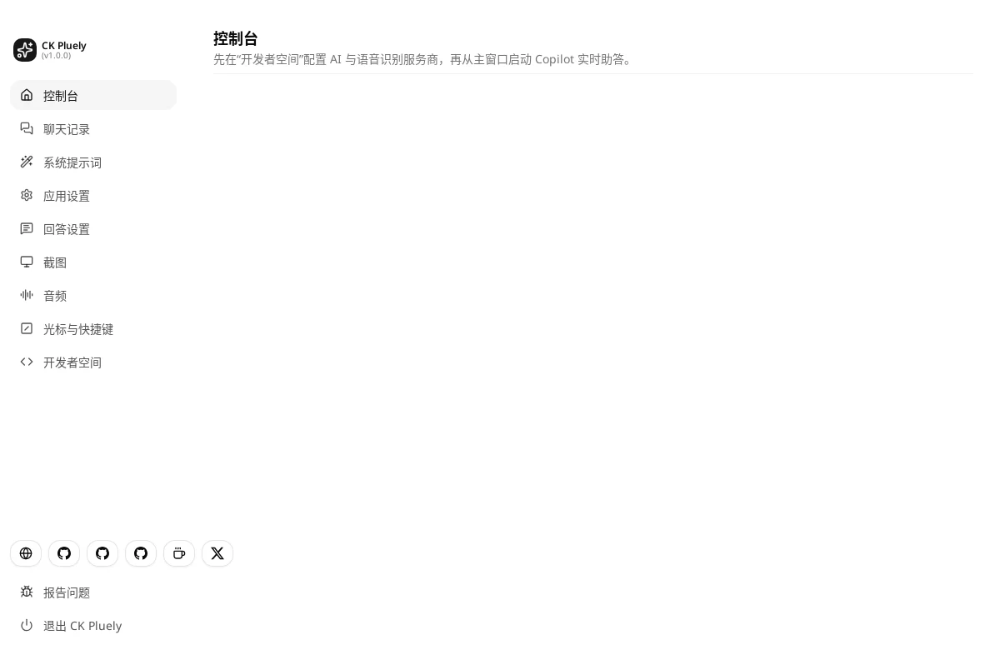<br>控制台首页 |
| 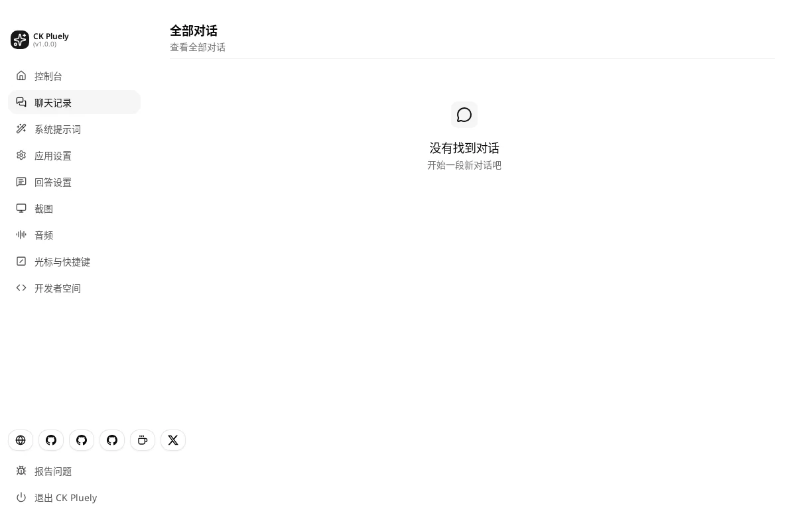<br>聊天记录 | 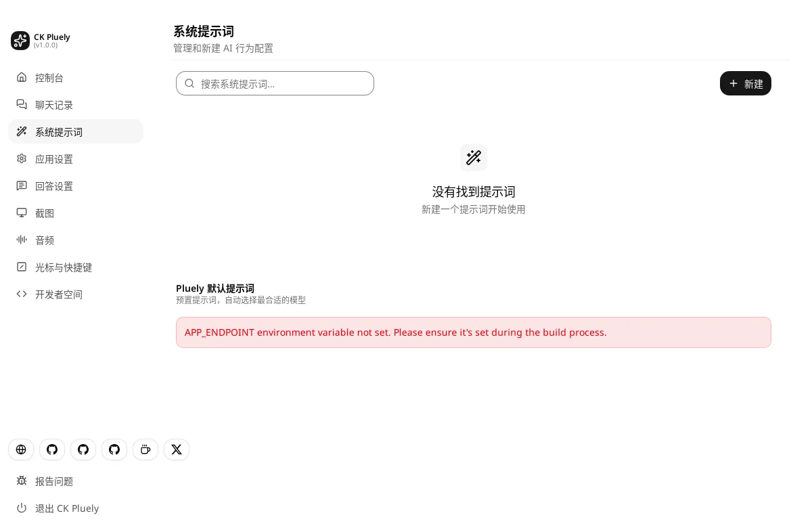<br>系统提示词 |
| 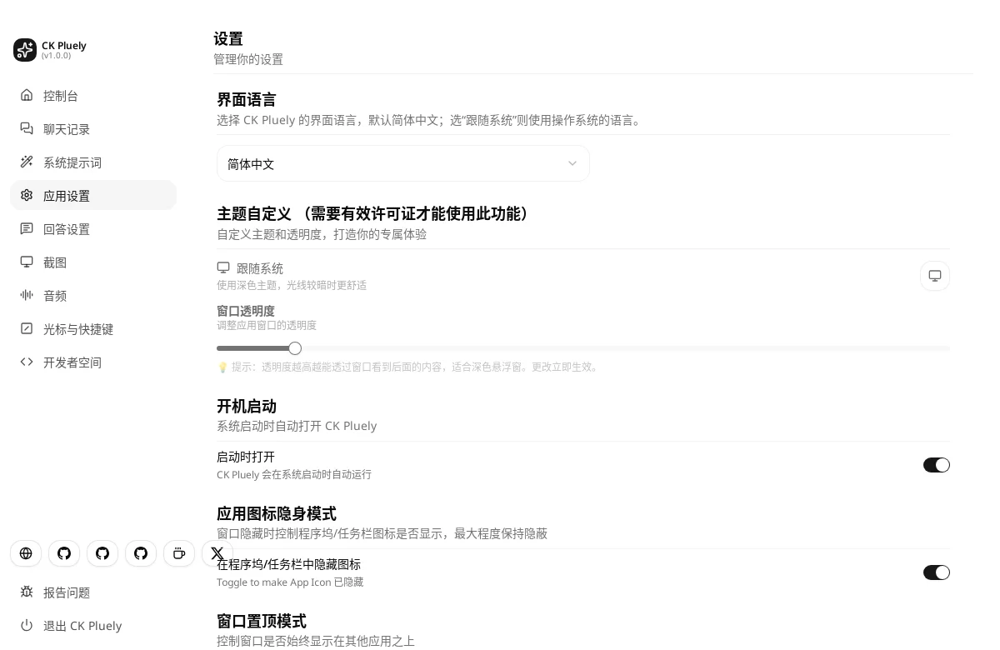<br>应用设置 | 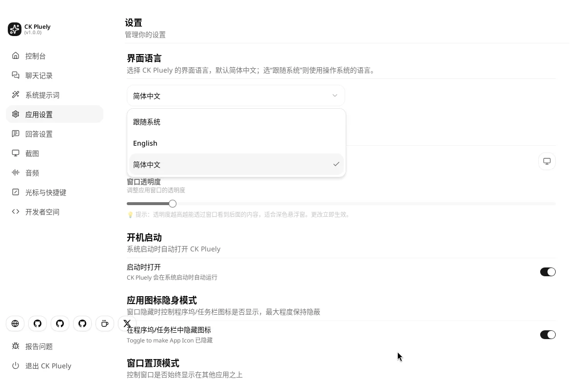<br>界面语言（默认简体中文，可切换） |
| <br>回答设置：长度与语言 | 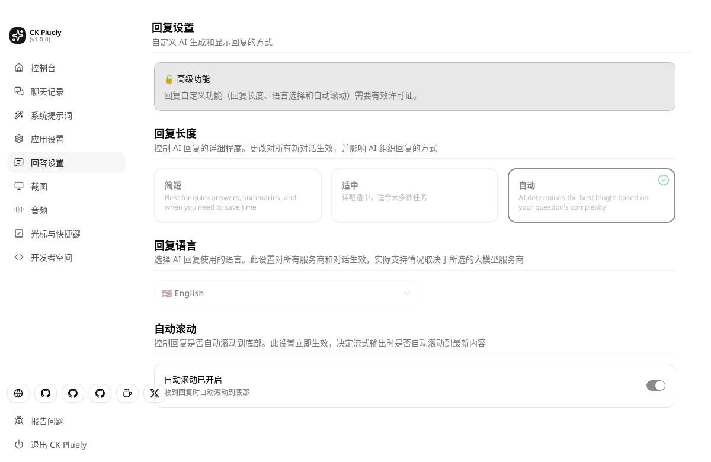<br>回答设置：自动滚动 |
| 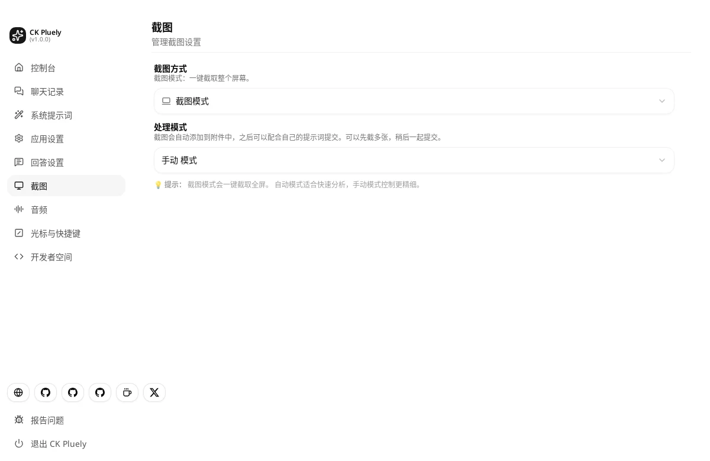<br>截图设置 | 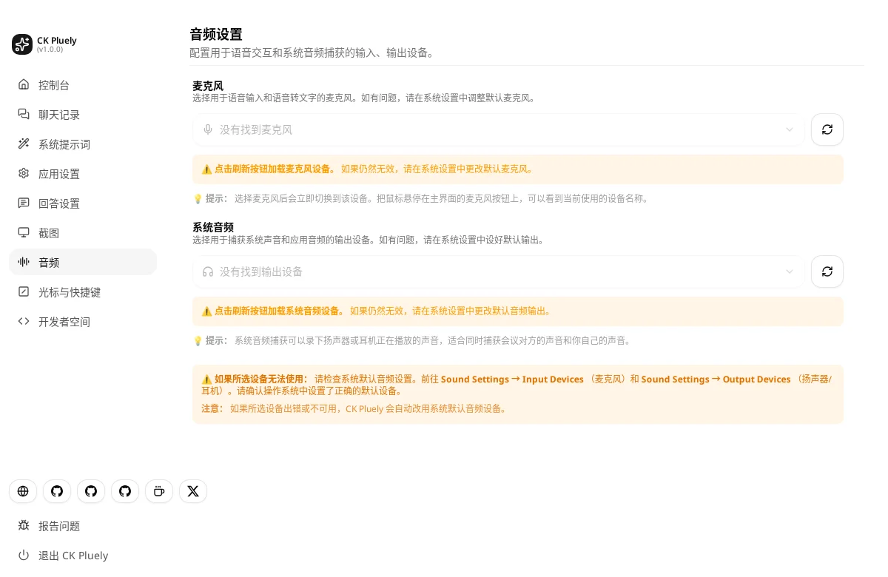<br>音频：麦克风与系统音频 |
| 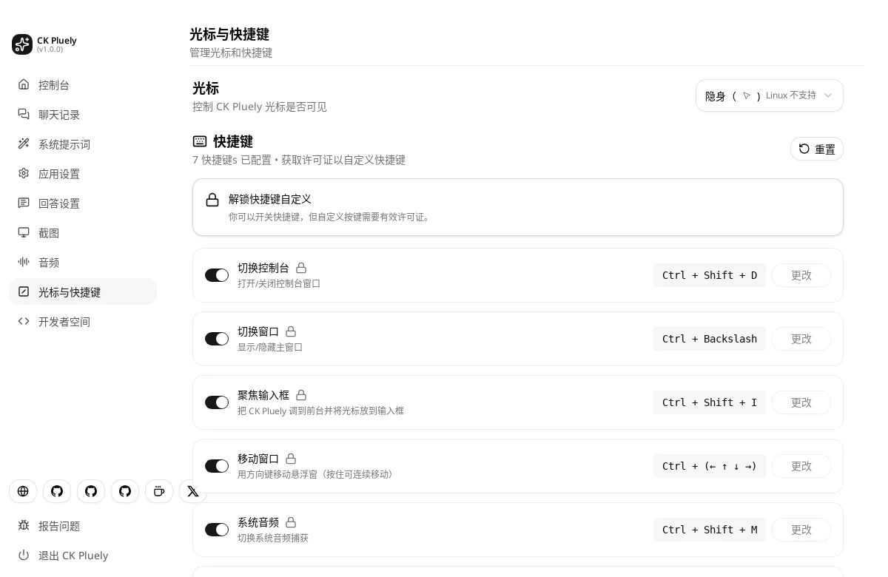<br>光标与快捷键 | 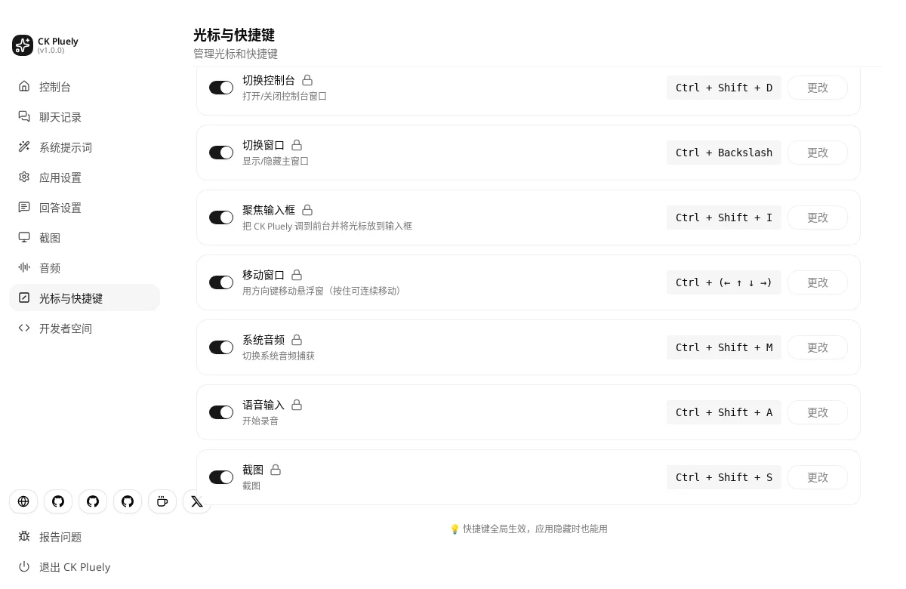<br>全局快捷键一览 |
| 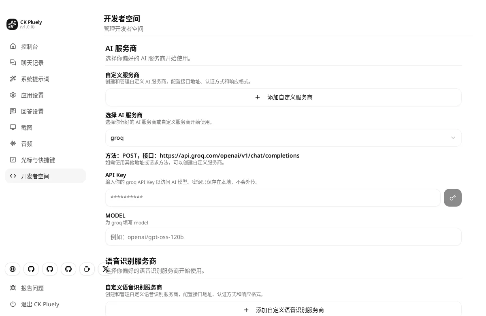<br>开发者空间：AI 服务商与 API Key | 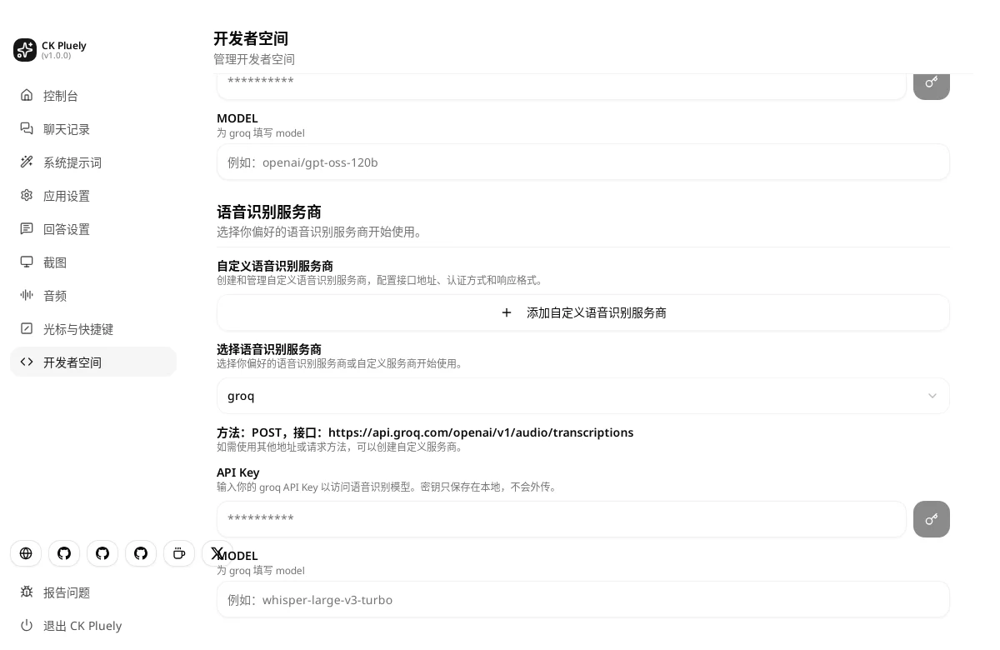<br>开发者空间：语音识别服务商 |
| 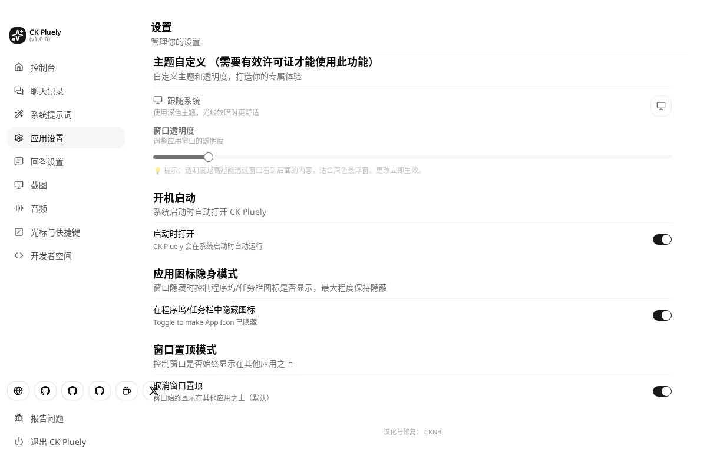<br>开机启动 / 隐身 / 置顶 | |

## 使用教程


🎬 完整视频：[中文视频](https://github.com/CKNB888/ck-pluely/releases/download/v1.0.0/ck-pluely-tutorial-zh.mp4) · [English video](https://github.com/CKNB888/ck-pluely/releases/download/v1.0.0/ck-pluely-tutorial-en.mp4)

1. **安装**：在 [Releases](https://github.com/CKNB888/ck-pluely/releases) 下载对应系统的安装包（macOS .dmg/.pkg、Windows .msi/.exe、Linux .deb/.rpm/.AppImage）。macOS 首次打开请右键 → 打开，或执行 `xattr -cr "/Applications/CK Pluely.app"`。
2. **打开悬浮条**：启动后屏幕顶部出现悬浮条，`Ctrl+\`（macOS 为 `Cmd+\`）显示 / 隐藏。
3. **打开控制台**：按 `Ctrl+Alt+Shift+D`（macOS `⌘⌥⇧D`）打开控制台窗口。
4. **确认界面语言**：「应用设置 → 界面语言」，默认简体中文，可切换为 English 或跟随系统。
5. **配置 AI 服务商**：「开发者空间」中选择服务商（Groq、OpenAI、Claude、Gemini、DeepSeek、通义千问、智谱等），填入 API Key 和模型名。密钥只保存在本机。
6. **配置语音识别**：同一页下方选择语音识别服务商并填写 Key。
7. **调整提示词与回答**：在「系统提示词」中选择或新建提示词；在「回答设置」中设置回答长度与语言。
8. **授予权限**：在「音频」中选择麦克风与系统音频，macOS 需授予麦克风、屏幕录制权限。
9. **开始使用**：在悬浮条输入问题，或用 `Ctrl+Alt+Shift+S` 截图提问、`Ctrl+Alt+Shift+R` 语音输入、`Ctrl+Alt+Shift+M` 捕获系统音频（macOS 把 Ctrl+Alt 换成 ⌘⌥）；显示/隐藏悬浮条 `Ctrl+Alt+\`，一键隐藏全部 `Ctrl+Alt+Shift+X`（macOS `⌘⌥⇧H`）。默认快捷键都用三个修饰键，避开腾讯会议、钉钉、飞书、微信、QQ、Zoom 的常用快捷键；欧洲键盘布局（AltGr = Ctrl+Alt）用户如与输入字符冲突，请在「快捷键」页改键。
10. **回看记录**：在「聊天记录」中查看历史对话。

## 下载与安装
到 [Releases](https://github.com/CKNB888/ck-pluely/releases) 下载 `ck-pluely_*`：
- macOS：`aarch64`（Apple Silicon）/ `x64`（Intel）的 `.dmg`。**未公证**：首次请右键 → 打开，或终端执行
  `xattr -cr "/Applications/CK Pluely.app"`；然后在 系统设置 → 隐私与安全性 中授予 **麦克风、屏幕与系统录音** 权限
- Windows：`-setup.exe`（NSIS）或 `.msi`；SmartScreen 点“更多信息 → 仍要运行”
- Linux：`.deb` / `.rpm` / `.AppImage`

## 快速上手（面试 / 上课）
1. 设置 → AI 服务商选 **groq**，填入你在 console.groq.com 申请的 Key 和模型（例如 `llama-3.3-70b-versatile`，以 Groq 文档为准）
2. 语音识别选 **groq**，模型填 `whisper-large-v3`
3. 打开系统音频 → 在“实时助手”中选预设（面试 / 上课答疑 / 会议），粘贴简历或讲义
4. 对方提问时自动出答案；不想自动就切到“手动”

## 从源码构建
```bash
npm ci
npm run tauri build          # 本机平台
npm run check:i18n           # 中英文条目一致性检查
```

## 赞助与广告合作 / Sponsorship & Ads
欢迎赞助本项目或洽谈广告合作，请添加微信 **1837620622**（请备注来意）。

## 许可证
GPL-3.0（见 [LICENSE](./LICENSE)）。Copyright © Srikanth Nani（上游 Pluely）；修改部分 © CKNB。

---

## English

**CK Pluely** is a Chinese-first fork of Pluely by Srikanth Nani (GPL-3.0, open-source v0.1.9), maintained by **CKNB** — <https://github.com/CKNB888/ck-pluely>. It installs alongside upstream (`io.github.cknb6.ckpluely`).

New in 1.0.0: a real-time copilot panel (auto-answer detected questions / answer everything / manual), interview / class / meeting presets, resume & notes context, Groq as default channel, extra providers (DeepSeek, Qwen/DashScope, Kimi, GLM, Doubao/Ark, SiliconFlow, LM Studio, …), SiliconFlow SenseVoice STT, Groq STT language auto-detect, Chinese default UI with English available, upstream auto-update disabled. Unsigned builds: on macOS run `xattr -cr "/Applications/CK Pluely.app"`. More: [README.en.md](./README.en.md).

### Sponsorship & Ads
Sponsorships and advertising partnerships are welcome — add WeChat **1837620622** (please mention your purpose).
